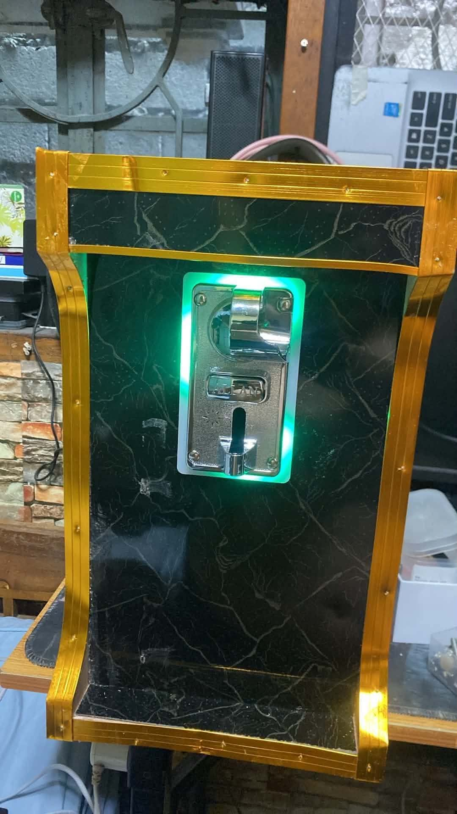
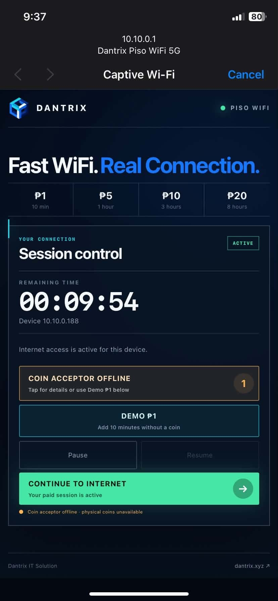
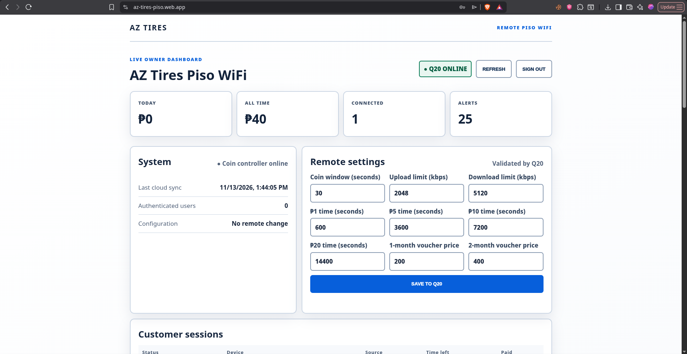

# AZ Tires Piso WiFi

Custom JCG Q20 + ESP32 coin-operated WiFi for AZ Tires.

## Deployment showcase

This is a deployed end-to-end system: a physical coin kiosk feeds an ESP32
controller, the Q20 manages paid access, customers use a mobile captive portal,
and the owner monitors the installation through a restricted remote dashboard.

<table>
  <tr>
    <td width="50%" valign="top">
      
      <br><sub><strong>Deployed hardware.</strong> The illuminated coin acceptor is connected to the optocoupler-isolated ESP32 controller.</sub>
    </td>
    <td width="50%" valign="top">
      
      <br><sub><strong>Mobile captive portal.</strong> Customers can view time, pause or resume access, and continue online. This captured fallback state keeps an active session usable while clearly reporting that the physical coin controller is offline.</sub>
    </td>
  </tr>
</table>

<p align="center">
  
  <br><sub><strong>Remote operations.</strong> The owner dashboard reports Q20 and coin-controller health, cloud synchronization, sessions, revenue, alerts, and a narrow set of Q20-validated configuration values.</sub>
</p>

## Current deployment status

- JCG Q20 is running ImmortalWrt, openNDS, the AZ Tires captive portal, and the owner dashboard.
- WAN receives internet from the upstream router.
- Customer networks target `AZ Tires Piso WiFi` and `AZ Tires Piso WiFi 5G` on `10.10.0.0/24`. The live router keeps its previous SSIDs until the on-site update is applied.
- The hidden ESP controller network targets `AZ-Tires-Controller` on `10.20.0.0/24`. Apply the matching Q20 and ESP32 changes together on site.
- The original Q20 firmware/configuration and original 4 MB ESP32 image are backed up.
- The ESP32 contains the AZ Tires controller firmware and reads the optocoupler on GPIO27.
- The ESP32 brownout was traced to weak PC USB power. It runs normally from a stable 5 V USB charger and reports heartbeats to the Q20.

## Customer features

- Large, high-contrast, one-screen mobile portal
- Physical coin workflow with an exclusive 30-second stacking window; each coin restarts the countdown
- Multiple coins combine into the best package tier (for example, five ₱1 coins receive the ₱5 package)
- ₱1 = 10 minutes
- ₱5 = 1 hour
- ₱10 = 2 hours
- ₱20 = 4 hours
- Pause and resume
- 1-month voucher = ₱200
- 2-month voucher = ₱400
- Each voucher permanently binds to the first WiFi MAC address that activates it

Voucher “months” are implemented as 30 and 60 days from first activation. Change the two prices in `/etc/az-tires-piso.conf` if the 2-month price should not be ₱400.

## Owner dashboard

From a PC connected to a Q20 LAN port, open:

`http://192.168.1.1/piso-admin/`

Use the router administrator username and password stored in `deployment-secrets/q20-admin.txt`. The dashboard and its API are protected by HTTP Basic authentication and are reachable only through the router-management side under the current firewall configuration. Do not expose the Q20 management interface to the WAN.

The dashboard shows:

- Today's and all-time revenue
- Coin revenue versus voucher revenue
- Connected and authenticated client counts
- Active, paused, and expired paid sessions
- Voucher status and bound device
- Invalid controller requests, invalid voucher attempts, and voucher device-mismatch warnings

Warnings identify activity worth reviewing; they are not proof that an attack occurred.

## Optional remote Firebase dashboard

The `firebase/` directory adds remote monitoring without exposing LuCI, SSH, or the local owner dashboard to the internet. The Q20 makes one outbound HTTPS synchronization per minute. The owner signs in to a static Firebase-hosted dashboard with a separate Firebase account.

The remote dashboard can show revenue, users, sessions, vouchers, alerts, controller health, and the last successful Q20 sync. It can change only a small validated allowlist of rates, bandwidth limits, voucher prices, and the coin window. It does not provide a remote shell, router reboot, firmware flashing, session deletion, or voucher creation.

Start with `START-HERE-OFFLINE.md`, then follow `firebase/FIREBASE-SETUP.md`. Copy the checked-in example configuration files and supply your own Firebase project values and administrator UIDs locally. Live Firebase configuration is intentionally excluded from Git.

## ESP32 wiring

Keep the ESP32 powered through its USB connector during commissioning.

Optocoupler output side:

- `VCC` → ESP32 `3V3`
- `GND` → ESP32 `GND`
- `OUT` → ESP32 `D27 / GPIO27`

Optocoupler input side:

- Coin acceptor pulse output → 12 V optocoupler input terminals, observing the module's marked polarity
- Never connect any 12 V line to GPIO27, 3V3, 5V, or another ESP32 pin
- The 12 V coin acceptor supply should be fused

Before applying the coin acceptor's 12 V supply, confirm that the ESP32 starts without brownouts, joins `AZ-Tires-Controller`, and appears online in the portal/dashboard. Then verify with a multimeter that GPIO27 stays between 0 V and 3.3 V while the 12 V side is active.

The firmware expects falling-edge pulses and maps 1, 5, 10, and 20 pulses to ₱1, ₱5, ₱10, and ₱20. Configure and test the ALLAN 1239A pulse output to match.

## Build and upload

The project-local toolchain contains Arduino CLI 1.5.1 and Espressif ESP32 core 3.3.11. This particular board's known-good flash settings are 4 MB, DIO, and 40 MHz.

```sh
./tools/bin/arduino-cli --config-file arduino-cli.yaml compile \
  --fqbn 'esp32:esp32:esp32:UploadSpeed=460800,FlashSize=4M,FlashFreq=40,FlashMode=dio' \
  --build-path esp32/AZTiresCoinController/build \
  esp8266/AZTiresCoinController

./tools/bin/arduino-cli --config-file arduino-cli.yaml upload \
  --port /dev/ttyUSB0 \
  --fqbn 'esp32:esp32:esp32:UploadSpeed=460800,FlashSize=4M,FlashFreq=40,FlashMode=dio' \
  --build-path esp32/AZTiresCoinController/build \
  esp8266/AZTiresCoinController
```

The source remains compatible with the temporary ESP8266, but GPIO27 is selected automatically for ESP32 builds.

## Backups and secrets

- Q20 backup: `router-backups/2026-09-07/q20-backup/`
- ESP32 pre-AZ Tires backup: `esp32/backups/2026-09-08/esp32-before-az-tires-piso.bin`
- ESP32 backup SHA-256: `39592e318c6f0cc73e79eae6d24d1703663937ca97d2fd055c7ae53dc5631918`
- Router and controller secrets: `deployment-secrets/` and `esp8266/AZTiresCoinController/secrets.h`

Never publish or upload the secrets directory, controller secrets, voucher database, transaction log, or router backups.
